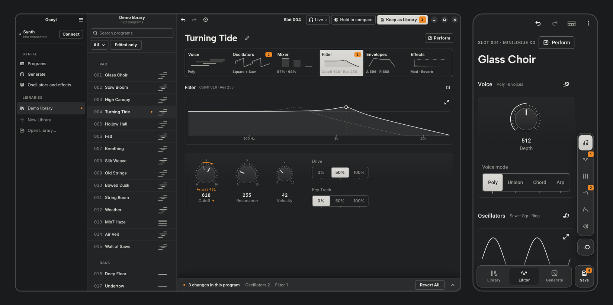
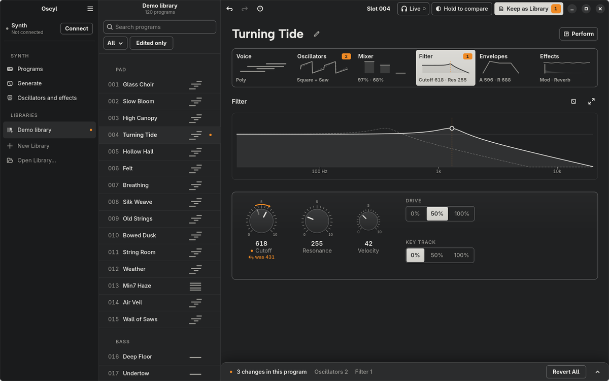
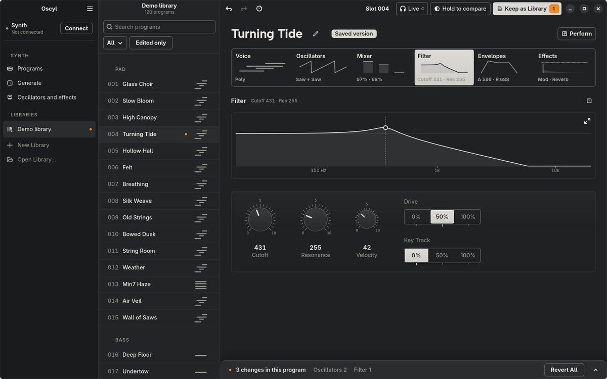
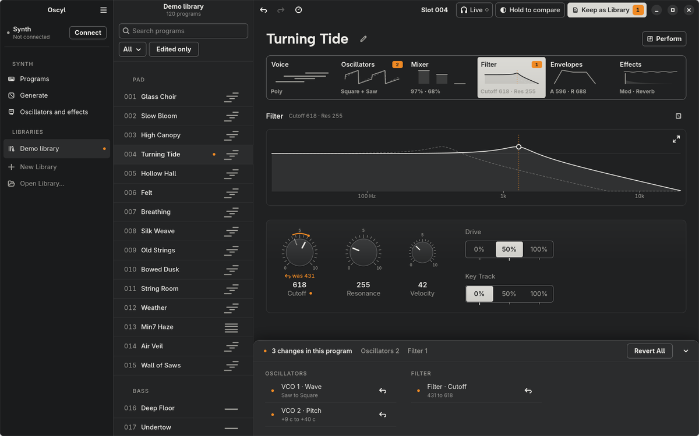
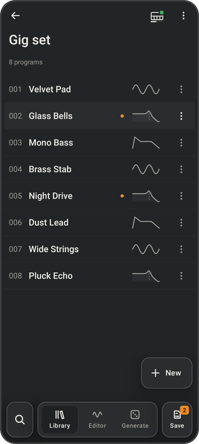
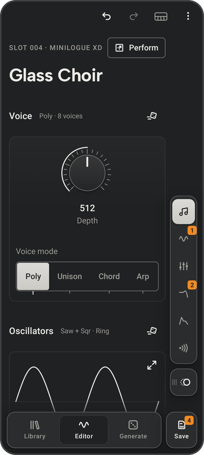

<div align="center">


# Oscyl

**The open-source librarian and sound editor for hardware synths.**<br>
For the KORG minilogue xd today, with the prologue and Sequential Prophet<br>
Rev2 in testing. On Linux, Windows, macOS, Android, iOS and the command line.

[](https://github.com/oscyl/oscyl/actions/workflows/ci.yml)
[](https://scorecard.dev/viewer/?uri=github.com/oscyl/oscyl)
[](#licence)

[Website](https://oscyl.github.io/oscyl/) ·
[Documentation](https://oscyl.github.io/oscyl/docs/) ·
[Download](#download) ·
[Synths](#supported-synths) ·
[Try it](#try-it-without-a-synth) ·
[Contribute](#contributing)

<picture>
  <source media="(prefers-color-scheme: light)" srcset="docs/images/hero-light.png">
  
</picture>

</div>

Oscyl is a librarian and sound editor for hardware synths. A librarian
keeps your synth's programs (its saved sounds) in files on your computer or
phone. Oscyl reads every program on your synth and draws each stage of the
sound. It is not a DAW, a sequencer or a preset converter: your synth plays,
and Oscyl keeps and shapes its sounds.

While you edit, the synth plays each change but stores nothing. Only Sync
writes to the synth. It writes only the slots you changed, after it backs
them up. Oscyl also works with the synth unplugged: open a library, edit,
and sync later.

**Status:** pre-alpha. Checked with a real minilogue xd: the desktop app and
the command line on Linux, the Android app, and `oscyl info` on Windows.
The prologue and the Prophet Rev2 are tested against simulators only.

## Features

<table>
<tr>
<td width="50%" valign="top">

<b>Edit along the signal.</b> Voice, oscillators, mixer, filter, envelopes,
effects: each stage has a live graph, and every dial keeps its saved value in
view. Each change plays on the synth at once.
</td>
<td width="50%" valign="top">

<b>Hold to compare.</b> Hold, and the synth plays the saved program; let go
and your edit is back. Every step can be undone.
</td>
</tr>
<tr>
<td valign="top">

<b>Generate.</b> Pick a character, shape it with four dials and get six new
sounds. Vary, breed or morph them, share one as a recipe code, keep the best.
</td>
<td valign="top">

<b>New oscillators.</b> A minilogue xd or prologue runs small programs
called units, made with KORG's logue SDK. Oscyl has one unit of its own that
makes new oscillators, and loads the one you keep into a free user slot.
You need it only for new oscillators.
</td>
</tr>
<tr>
<td valign="top">

<b>Your units.</b> A shelf of logue SDK unit files, one click from a free slot.
Generate uses the units your synth holds, with their real parameters.
</td>
<td valign="top">

<b>Safe sync.</b> Every change listed, the touched slots backed up, then only
those slots written and confirmed one by one. Factory slots never change.
</td>
</tr>
</table>

**On your phone,** the same features in an app made for one thumb:

<table>
<tr>
<td width="25%"></td>
<td width="25%"></td>
<td width="25%"></td>
<td width="25%"></td>
</tr>
<tr>
<td align="center"><sub>Library</sub></td>
<td align="center"><sub>Editor</sub></td>
<td align="center"><sub>Generate</sub></td>
<td align="center"><sub>Perform</sub></td>
</tr>
</table>

Also: with **Live** on, a knob turned on a minilogue xd moves in the app too.
There are light, dark and AMOLED themes, large text, screen readers, English
and Italian, and an `oscyl` command line for backups, diffs and scripts.

## Download

| Platform | Get it |
|----------|--------|
| Linux | [Flatpak](https://github.com/oscyl/oscyl/releases) (GNOME app) and the `oscyl` CLI |
| Android | [APK](https://github.com/oscyl/oscyl/releases) for phones, foldables and tablets |
| Windows | An [installer](https://github.com/oscyl/oscyl/releases) or a zipped folder, and the `oscyl` CLI. The installer needs no admin rights. To remove Oscyl, use Settings > Apps |
| macOS | [`Oscyl.app`](https://github.com/oscyl/oscyl/releases) and the `oscyl` CLI |
| iOS | [Build from source](docs/how-to/mobile.md#run-the-ios-app) for now |

Each release lists the SHA-256 checksum of every file, and the release
workflow signs a record of how each file was built. The desktop app on
Windows and macOS is not yet tested with a synth.

## Supported synths

| Synth | State |
|-------|-------|
| KORG minilogue xd | Checked on the synth (firmware 2.10) |
| KORG prologue (8 and 16) | Tested against a simulator only; hardware testers wanted |
| Sequential Prophet Rev2 | Tested against a simulator only; hardware testers wanted |

Each synth has its own driver, a Rust crate that teaches Oscyl the synth's
MIDI messages and program format. CI tests every driver against a simulator
on every commit. [Supported synths](docs/reference/synths.md) says what works
on each one.

To add your synth, do the tutorial [Your first driver](docs/tutorials/first-driver.md),
then follow [Add a driver for a new synth](docs/how-to/add-a-synth.md). No
time to write one? [Ask for a driver](https://github.com/oscyl/oscyl/issues/new/choose).

## Try it without a synth

The simulated synth answers like a real one, with no sound. You need Rust
1.92 or newer:

```sh
git clone https://github.com/oscyl/oscyl && cd oscyl
cargo run -p oscyl-cli -- --simulator info    # any desktop
cargo run -p oscyl-gtk -- --simulator         # the Linux app
```

The tutorial [Try Oscyl without a synth](docs/tutorials/try-without-a-synth.md)
goes further. Other builds: [the desktop and the command line](docs/how-to/build.md),
[Android and iOS](docs/how-to/mobile.md).

## Documentation

The documentation is a book, online at
[oscyl.github.io/oscyl/docs](https://oscyl.github.io/oscyl/docs/):

- **Start here:** four short pages, from
  [what Oscyl is, and what it is not](docs/start/what-is-oscyl.md) to
  [a tour of the code](docs/start/code-tour.md).
- **Tutorials:** [try Oscyl without a synth](docs/tutorials/try-without-a-synth.md)
  and [your first driver](docs/tutorials/first-driver.md).
- **How-to guides:** [add a synth](docs/how-to/add-a-synth.md),
  [build](docs/how-to/build.md), [run the checks](docs/how-to/run-the-checks.md),
  [translate](docs/how-to/translate.md) and more.
- **Reference:** [the driver contract](docs/reference/driver-contract.md),
  [the command line](docs/reference/cli.md), the
  [library format](docs/reference/oscyllib-format.md) and more.
- **Explanation:** [the architecture](docs/explanation/architecture.md) and
  [the oscillator unit](docs/explanation/oscillator-unit.md).

## Contributing

We most want hardware testers, drivers for new synths, and translations.
Read [CONTRIBUTING.md](CONTRIBUTING.md), then ask in
[Discussions](https://github.com/oscyl/oscyl/discussions). To report a
security problem, follow [SECURITY.md](SECURITY.md).

## Licence

Code: [MIT licence](LICENSE-MIT) or [Apache License 2.0](LICENSE-APACHE), at
your option. The bundled Albert Sans font uses the SIL Open Font License 1.1.
The `units/` folder holds a few header and linker files from KORG's logue
SDK, under their BSD licence.

Oscyl is an independent project. No synth maker supports or endorses it.
"KORG", "minilogue", "prologue" and "logue" are trademarks of KORG Inc.;
"Sequential" and "Prophet" are trademarks of their owner. This repository
holds no vendor firmware or presets, and no vendor code beyond those logue
SDK files.
