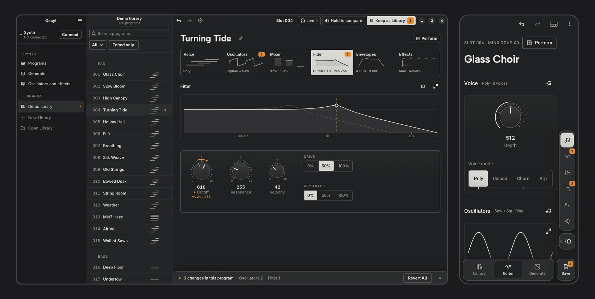
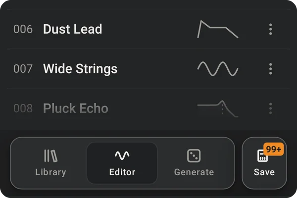
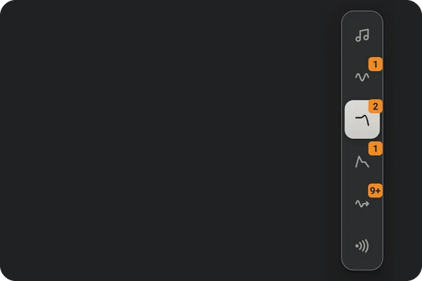
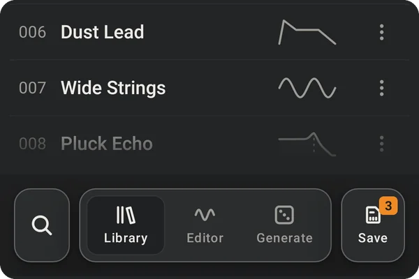
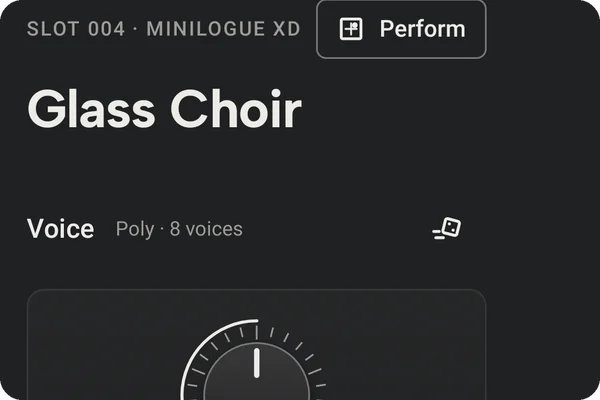
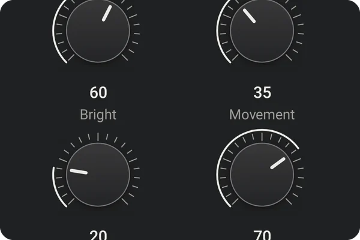
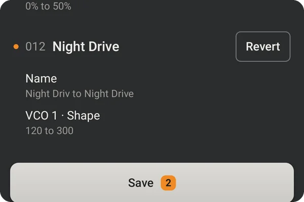
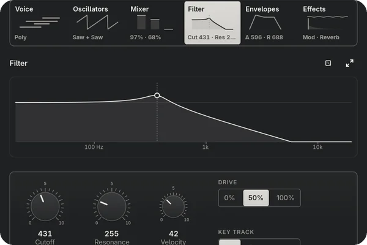
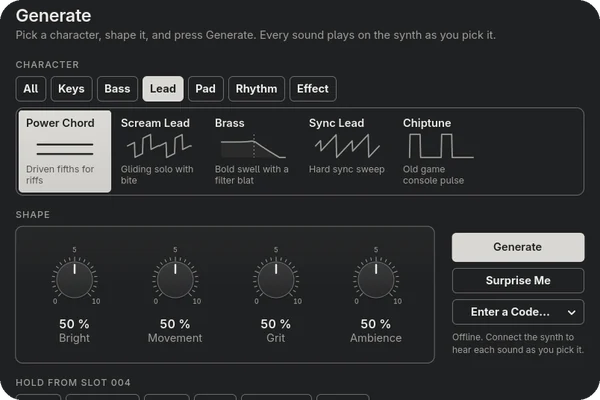
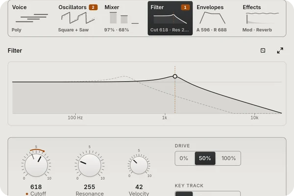

<div align="center">


# Oscyl

**The open-source librarian and sound editor for hardware synths.**<br>
Read, edit, back up and sync your synth's programs on Linux, Android, iOS and the command line.

[](https://github.com/oscyl/oscyl/actions/workflows/ci.yml)
[](https://github.com/oscyl/oscyl/actions/workflows/android.yml)
[](https://github.com/oscyl/oscyl/actions/workflows/ios.yml)
[](https://github.com/oscyl/oscyl/actions/workflows/codeql.yml)
[](https://scorecard.dev/viewer/?uri=github.com/oscyl/oscyl)
[](#licence)
[](https://github.com/oscyl/oscyl/stargazers)

[Website](https://oscyl.github.io/oscyl/) ·
[Try it](#try-it-without-a-synth) ·
[Synths](#supported-synths) ·
[Build](docs/building.md) ·
[Contribute](#contributing)



</div>

Oscyl reads every program on your synth, shows each stage of the sound as a
picture, and writes back only the slots you changed, after backing them up.
It works with the synth unplugged too: open a library file, edit it, sync
later.

**Status:** pre-alpha. Early builds are on the
[Releases](https://github.com/oscyl/oscyl/releases) page: the Linux Flatpak,
the Android APK and the `oscyl` command-line tool for Linux, macOS and
Windows.

## See it move

<table>
<tr>
<td width="33%" valign="top">

<br><b>The island</b><br>
<sub>Navigation and Save float over your programs. Save counts your edits, shows its progress and turns into Sync.</sub>
</td>
<td width="33%" valign="top">

<br><b>The stage rail</b><br>
<sub>One thumb on the right edge: tap a stage, or hold and slide to read every stage with its values.</sub>
</td>
<td width="33%" valign="top">

<br><b>Search and undo</b><br>
<sub>The island becomes the search field, and the place where a removed program comes back.</sub>
</td>
</tr>
<tr>
<td width="33%" valign="top">

<br><b>Hold to compare</b><br>
<sub>Hold, and the synth plays the saved version. Let go, and your edit is back.</sub>
</td>
<td width="33%" valign="top">

<br><b>Generate</b><br>
<sub>Four dials shape a character. Oscyl deals six sounds; keep the ones worth a slot.</sub>
</td>
<td width="33%" valign="top">

<br><b>Safe sync</b><br>
<sub>Review every change, then watch each slot written and confirmed. Only edited slots change.</sub>
</td>
</tr>
<tr>
<td width="33%" valign="top">

<br><b>Edit along the signal</b><br>
<sub>On Linux: the curve moves with the dial, the saved curve stays behind it, and the stage counts the edit.</sub>
</td>
<td width="33%" valign="top">

<br><b>Generate on the desktop</b><br>
<sub>Pick a character, shape it, and keep a sound in a slot or in a library.</sub>
</td>
<td width="33%" valign="top">

<br><b>Light, dark, AMOLED</b><br>
<sub>Three themes on every platform, with large text and screen readers supported.</sub>
</td>
</tr>
</table>

## Why Oscyl

- **Nothing is lost.** A sync shows which slots change, backs them up,
  writes only those and confirms each one.
- **You see the sound.** Every stage has a live graph, and every control
  shows its saved value beside the edited one.
- **You hear it at once.** Each change plays on the synth as you make it,
  without storing anything.
- **It finds new sounds.** Generate deals six sounds from a character and
  four dials; vary them, breed two, keep the best.
- **It is for everyone.** Light, dark and AMOLED themes, large text, screen
  readers, phone to desktop layouts, English and Italian.

## Supported synths

| Synth | State |
|-------|-------|
| KORG minilogue xd | Validated on hardware (firmware 2.10) |
| KORG prologue (8 and 16) | Proven against its simulator; hardware testers wanted |
| Sequential Prophet Rev2 | Proven against its simulator; hardware testers wanted |

Each synth has its own driver, tested against a simulator on every commit.
To add yours, read the [driver guide](docs/drivers.md).

## Platforms

| Platform | What you get | State |
|----------|--------------|-------|
| Linux | GNOME app (GTK 4, libadwaita), Flatpak, `oscyl` CLI | Tested with a minilogue xd |
| Android | Compose Multiplatform app for phones, foldables and tablets | Tested on the emulator; hardware testers wanted |
| iOS | The same Compose Multiplatform app | Builds; not yet run on a device |
| macOS | `oscyl` CLI (CoreMIDI) | Builds and passes its tests; not yet run with a synth |
| Windows | `oscyl` CLI (WinMM) | Builds and passes its tests; not yet run with a synth |

There is no desktop app for macOS or Windows yet.

## Try it without a synth

The simulated synth answers like a real one, with no sound:

```sh
git clone https://github.com/oscyl/oscyl && cd oscyl
cargo run -p oscyl-cli -- --simulator info    # any desktop
cargo run -p oscyl-gtk -- --simulator         # the Linux app
```

Android, iOS and Flatpak: [docs/building.md](docs/building.md).

## Contributing

Oscyl wants three kinds of help most:

- **Hardware testers.** Own a prologue or a Prophet Rev2, or an Android
  phone and a USB cable? [Say so in Discussions](https://github.com/oscyl/oscyl/discussions).
- **Drivers.** Add your synth with the [driver guide](docs/drivers.md), or
  [ask for one](https://github.com/oscyl/oscyl/issues/new/choose).
- **Translations.** See [po/README.md](po/README.md).

[CONTRIBUTING.md](CONTRIBUTING.md) covers setup, tests and sending changes,
and [GOVERNANCE.md](GOVERNANCE.md) covers roles, decisions and RFCs. Report
security problems as described in [SECURITY.md](SECURITY.md).

## Trademarks

Oscyl is an independent project. It is not affiliated with, endorsed by or
supported by any synth maker. "KORG", "minilogue", "prologue" and "logue" are
trademarks of KORG Inc.; "Sequential" and "Prophet" are trademarks of their
owner. This repository contains no vendor firmware, presets or software.

## Licence

Code: [Apache License 2.0](LICENSE-APACHE) or [MIT licence](LICENSE-MIT), at
your option. The bundled Albert Sans font is under the SIL Open Font License
1.1.

---

<div align="center">

If Oscyl is useful to you, a star helps other synth owners find it.

[](https://github.com/oscyl/oscyl/stargazers)
[](https://github.com/oscyl/oscyl/fork)
[](https://github.com/oscyl/oscyl/subscription)

<a href="https://github.com/oscyl/oscyl/stargazers"></a>

<a href="https://github.com/oscyl/oscyl/graphs/contributors"></a>

</div>
