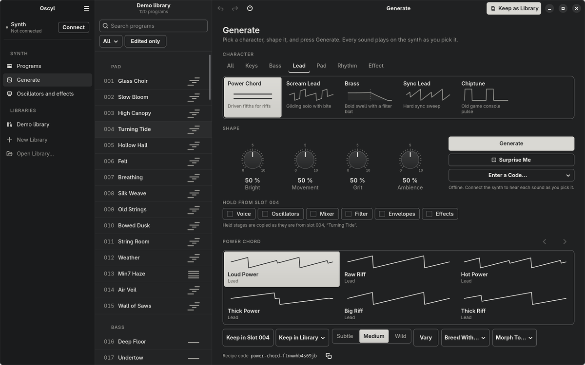
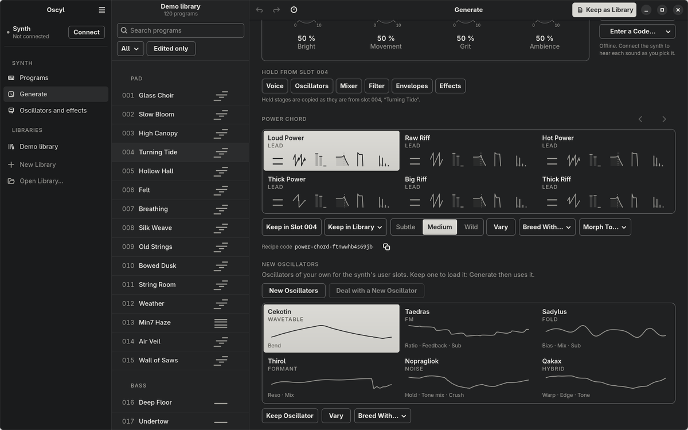
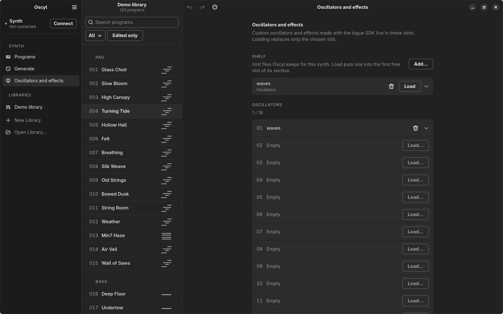
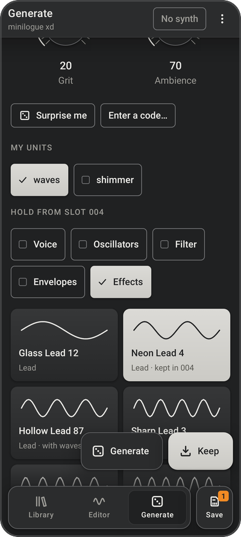
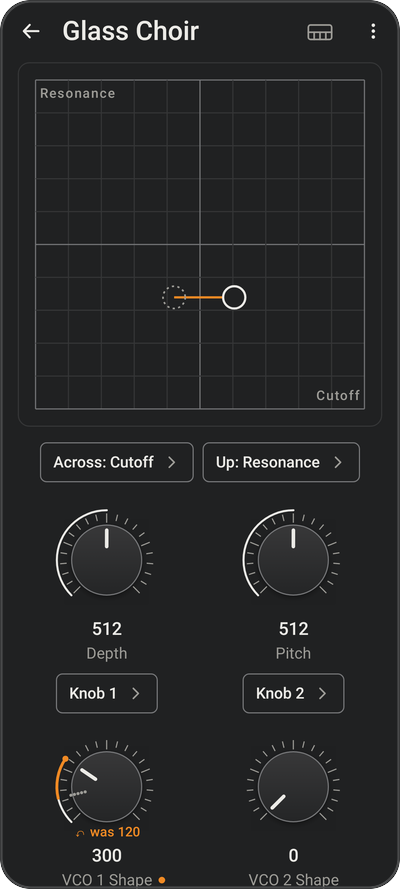

<div align="center">


# Oscyl

**The open-source librarian and sound editor for hardware synths.**<br>
Read, edit, back up and sync your synth's programs on Linux, Android, iOS and the command line.

[](https://github.com/oscyl/oscyl/actions/workflows/ci.yml)
[](https://scorecard.dev/viewer/?uri=github.com/oscyl/oscyl)
[](#licence)

[Website](https://oscyl.github.io/oscyl/) ·
[Download](#download) ·
[Synths](#supported-synths) ·
[Try it](#try-it-without-a-synth) ·
[Contribute](#contributing)


</div>

Oscyl reads every program on your synth, draws each stage of the sound, and
writes back only the slots you changed, after backing them up. It works with
the synth unplugged too: open a library, edit, sync later.

**Status:** pre-alpha, validated on a KORG minilogue xd.

## Features

<table>
<tr>
<td width="50%" valign="top">

<b>Edit along the signal.</b> Voice, oscillators, mixer, filter, envelopes,
effects: each stage has a live graph, and every dial keeps its saved value in
view. Each change plays on the synth at once.
</td>
<td width="50%" valign="top">

<b>Hold to compare.</b> Hold, and the synth plays the saved program; let go
and your edit is back. Every step can be undone.
</td>
</tr>
<tr>
<td valign="top">

<b>Generate.</b> Pick a character, shape it with four dials and get six new
sounds. Vary, breed or morph them, share one as a recipe code, keep the best.
</td>
<td valign="top">

<b>New oscillators.</b> Oscyl makes user oscillators of its own for the
minilogue xd and prologue, and loads the one you keep into a free slot.
</td>
</tr>
<tr>
<td valign="top">

<b>Your units.</b> A shelf of logue SDK unit files, one click from a free slot.
Generate uses the units your synth holds, with their real parameters.
</td>
<td valign="top">

<b>Safe sync.</b> Every change listed, the touched slots backed up, then only
those slots written and confirmed one by one. Factory slots never change.
</td>
</tr>
</table>

**On your phone,** the same features in an app made for one thumb:

<table>
<tr>
<td width="25%"></td>
<td width="25%"></td>
<td width="25%"></td>
<td width="25%"></td>
</tr>
<tr>
<td align="center"><sub>Library</sub></td>
<td align="center"><sub>Editor</sub></td>
<td align="center"><sub>Generate</sub></td>
<td align="center"><sub>Perform</sub></td>
</tr>
</table>

Also: with **Live** on, turning a knob on the synth moves it in the app.
There are light, dark and AMOLED themes, large text, screen readers, English
and Italian, and an `oscyl` command line for backups, diffs and scripts.

## Download

| Platform | Get it |
|----------|--------|
| Linux | [Flatpak](https://github.com/oscyl/oscyl/releases) (GNOME app) and the `oscyl` CLI |
| Android | [APK](https://github.com/oscyl/oscyl/releases) for phones, foldables and tablets |
| macOS, Windows | The desktop app (`Oscyl.app`, a zipped folder on Windows) and the `oscyl` CLI from [Releases](https://github.com/oscyl/oscyl/releases). The app is not yet tested with a synth there |
| iOS | [Build from source](docs/building.md#ios) for now |

Every release lists SHA-256 sums and carries signed build provenance.

## Supported synths

| Synth | State |
|-------|-------|
| KORG minilogue xd | Validated on hardware (firmware 2.10) |
| KORG prologue (8 and 16) | Proven against its simulator; hardware testers wanted |
| Sequential Prophet Rev2 | Proven against its simulator; hardware testers wanted |

Each synth has its own driver, tested against a simulator on every commit.
To add yours, read the [driver guide](docs/drivers.md).

## Try it without a synth

The simulated synth answers like a real one, with no sound:

```sh
git clone https://github.com/oscyl/oscyl && cd oscyl
cargo run -p oscyl-cli -- --simulator info    # any desktop
cargo run -p oscyl-gtk -- --simulator         # the Linux app
```

Android, iOS and Flatpak builds: [docs/building.md](docs/building.md).

## Contributing

Hardware testers, drivers for new synths and translations are the most
welcome help. Start with [CONTRIBUTING.md](CONTRIBUTING.md); ask in
[Discussions](https://github.com/oscyl/oscyl/discussions). Security problems:
[SECURITY.md](SECURITY.md).

## Licence

Code: [Apache License 2.0](LICENSE-APACHE) or [MIT licence](LICENSE-MIT), at
your option. The bundled Albert Sans font is under the SIL Open Font License
1.1; the logue SDK files in `units/` are under their BSD licence.

Oscyl is an independent project, not affiliated with or endorsed by any synth
maker. "KORG", "minilogue", "prologue" and "logue" are trademarks of KORG
Inc.; "Sequential" and "Prophet" are trademarks of their owner. This
repository contains no vendor firmware, presets or software.
